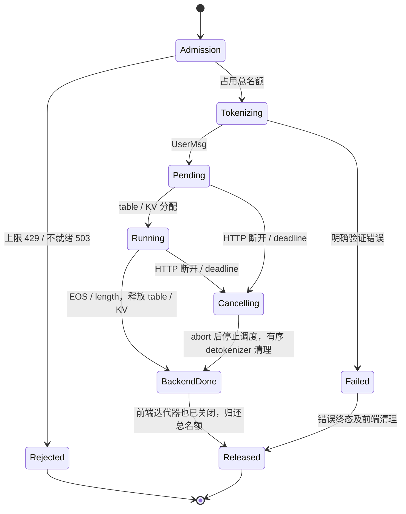
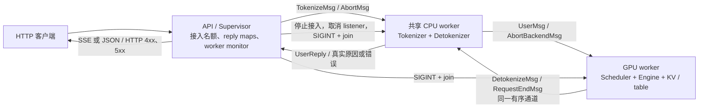

# I1 生命周期修复与复现

本轮使用本机 RTX 5060 Laptop 8 GiB、Qwen3-0.6B BF16、TP=1，
共享 tokenizer/detokenizer，Graph 与 Overlap 关闭。原始
`results/i_minisglang/i1_lifecycle/attempt001`–`attempt004`、源码快照、配置和失败证据不变。
修复验收结果单独存放在 `results/i_minisglang/i1_repaired/`；实验状态以该目录的审计为准。

## 七个补丁的职责

[`patches/minisgl-i1/series.json`](../patches/minisgl-i1/series.json) 固定上游 commit、
补丁 SHA256 和重放后的 Git tree。每个补丁对应一个独立提交。

| 补丁 | 问题原因 | 修复及边界 |
|---|---|---|
| 0001 frontend | 外层在 finished 后 break，异步迭代器 yield 之后的删除不保证执行；响应头发送失败时 body 迭代器甚至未启动 | `wait_for_ack` 的 finally 清理；调用方用 `aclosing` 显式关闭；整个 ASGI 响应还有 finally，覆盖未启动 body、提前退出、异常及任务取消 |
| 0002 cancel | 原 tokenizer 只向 Scheduler 转发 abort，detokenizer 不知道请求已停止 | Scheduler 释放资源后，在输出 token 的同一个 PUSH 通道发送 `RequestEndMsg`；detokenizer 按消息顺序删除 UID，再确认前端 |
| 0003 protocol | API 无论 EOS 还是预算耗尽都写 stop | Scheduler 计算 stop/length，经消息 schema、序列化和 detokenizer 透传；流式与非流式共用真实原因，EOS 与长度同时命中时 EOS 优先 |
| 0004 validation | 超上下文输入在 Scheduler 被静默丢弃 | 发回带 400 错误的终态；API 等首个 token 或验证结果再发响应头；等于上下文上限也拒绝，剩余 1 个位置时截减输出预算并返回 length |
| 0005 health | API 未持有 worker 存活信息，健康检查固定 ok | 持有全部 worker 句柄；启动等待有期限；运行期轮询存活；任一 worker 退出即停止接入，唤醒在途请求并返回明确错误；`/ready`、`/health`、`/v1`、模型列表返回 503 |
| 0006 shutdown | listener 无句柄、ZMQ 默认 linger，以及非 daemon 子进程没有明确回收流程 | 取消并等待监听任务，socket `close(linger=0)`，停止并 join 自有子进程；SIGINT 共用 4 秒，再按 1.5/0.5 秒期限升级 SIGTERM/SIGKILL；升级会被审计判失败，不能冒充优雅关闭 |
| 0007 admission | running slot=1 只限制执行，不限制 pending | 默认总名额 4；同时计入 tokenizing、pending、running、cancelling 和等待前端消费完的请求；超过返回 429；必须后端已结束且前端已释放才能归还 |

取消通知不能仅在 tokenizer 收到 abort 时立即删除 decode_map：Scheduler 之前已发送的 token
可能尚在通道里，会重新创建状态。这里用同一 Scheduler→Detokenizer 通道的有序结束确认，
让清理排在所有先前 token 之后；不积累永久 cancelled UID tombstone。
为保证该顺序，补丁会拒绝独立 tokenizer 进程或开启 Overlap 的启动配置。
后续 I2 比较 Overlap 前需要扩展在途 batch 的取消处理和重新验收，不能只删除启动限制。
TP2/4 也尚未验收。

## 请求和进程状态



客户端只记录一个终态。服务端资源确认独立记录：客户端 cancelled 不等于 Scheduler 已停止，
后端 finished 也不等于慢客户端的前端缓冲已经释放。
Radix 可驱逐前缀和 CUDA allocator reserved 可保留；table、活跃 KV 引用、prefix 锁、
pending/running 和各前端 map 则必须按预算释放。



API 通过 multiprocessing spawn 启动两个业务 worker，另有 Python resource tracker。
runner 发关闭信号给 API，由 Supervisor 负责停止子进程；最后核对整个专用进程树和显存。
worker 故障后不自动重启，也不把旧请求重试到新服务。

## 本机运行手册

依赖和工具链沿用 [原运行手册](minisglang_service_walkthrough.md)。无需重装原训练环境。
准备补丁时保留 `runs/vendor/mini-sglang` 为干净固定上游；不修改 editable 安装指向，
新 launcher 将修复 checkout 的 `python/` 放在 import 路径首位，spawn 子进程同样执行该入口。

```bash
runs/envs/mini-sglang/bin/python scripts/prepare_i1_lifecycle.py
runs/envs/mini-sglang/bin/python -m unittest discover -s tests -p test_i1_lifecycle_repairs.py -v
runs/envs/mini-sglang/bin/python -m unittest discover -s tests -p test_online_client.py -v
runs/envs/mini-sglang/bin/python scripts/run_i1_repaired.py --attempt local001 --scenario healthy
runs/envs/mini-sglang/bin/python scripts/audit_i1_repaired.py --directory results/i_minisglang/i1_repaired/local001
```

用新的 attempt 名称依次执行 `scheduler_fault`、`tokenizer_fault`、`shutdown_active`，每次启动新进程。
它们先完成真实 EOS 请求，再在一个请求 decode、另一个请求 pending 时注入信号。
正常矩阵覆盖流式/非流式 stop、length、非流式连接关闭、排队取消、decode 断开与 deadline，
还验证上下文越界/相等/剩余一位、非法参数、重复外部 header 和 12 个同时到达请求的过载与恢复。
X-Request-ID 只用于关联；两次相同 header 仍创建两个 UID，不提供服务端幂等契约。

所有 GPU 场景共用 `runs/tmp/h2_runner.lock`，不得并行运行。
启动及首请求编译各有 600 秒预算，常规客户端请求 30 秒，取消清理 5 秒、关闭 10 秒、
worker 故障客户端传播 3 秒。发生错误后保留该 attempt，修复后使用新名称；不覆盖失败。
完整日志留在忽略的 `runs/logs/`，紧凑事件、请求、配置、依赖/模型哈希、补丁和源码快照进 Git。

独立审计重新解析 raw JSONL，对照客户端事件、真实后端 token、资源状态、接入释放和进程回收，
并核对哈希。审计不读取 runner 的通过布尔值来代替证据。每次审计保存 `audit_source.py`；
后续重算使用该文件的 `--check-only`，以保留审计版本。只做了 finite logits 检查，
不把它当作与参考实现的逐 logits 数值等价，也不从带逐步观测开销的 I1 推出性能结论。

最终四场景汇总重算：

```bash
runs/envs/mini-sglang/bin/python scripts/audit_i1_suite.py \
  --directories results/i_minisglang/i1_repaired/accept006_healthy \
    results/i_minisglang/i1_repaired/accept010_scheduler_fault \
    results/i_minisglang/i1_repaired/accept011_tokenizer_fault \
    results/i_minisglang/i1_repaired/accept012_shutdown_active \
  --cpu-evidence results/i_minisglang/i1_repaired/cpu_tests.json \
  --output results/i_minisglang/i1_repaired/acceptance.json --check-only
```

首次探索轮 `accept001_healthy` 保留了 2 秒 SIGINT 等待导致内部 SIGTERM 升级的失败。
这说明“runner 未强杀”不足以证明优雅关闭，审计同时检查 Supervisor 的升级信号。
正式补丁等待 4 秒，并记录 Scheduler.shutdown 的进入/返回，区分显式清理和进程最终退出。
该证据不能唯一解释原始 attempt004 的全部关闭根因。

后续 runner 也保留了两类失败：PID 在 `is_running` 与 `status` 读取之间退出导致扫描异常，
以及并发 HTTP 先后顺序使原定 queued 请求先完成。前者按已退出处理并补 CPU 竞争测试；
后者必须先观测 Scheduler 的真实 running/pending，再注入故障，不能用客户端提交顺序假定排队。

当前名额限制面向已进入推理请求生命周期的请求数，不是 HTTP 请求体字节数、连接数或 OS backlog
的内存保证。该单机服务用于后续实验；独立 tokenizer、Overlap、TP、多租户配额、重启恢复和
生产网关治理需要分别验证。个人复盘、面试指南和知识验收留待整体实验完成后统一整理。
