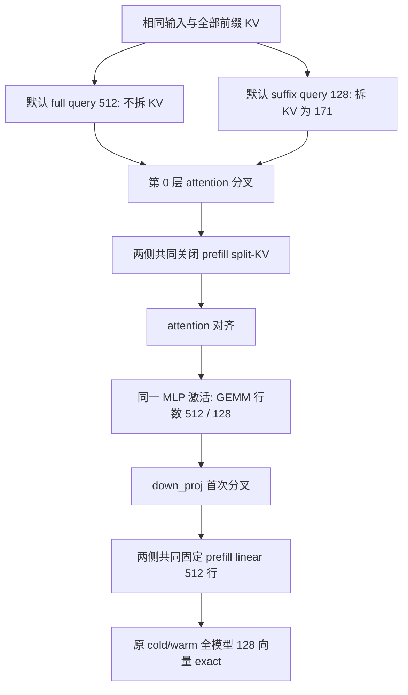

# I2 数值分叉：定位与显式控制策略

原 I2 v1 的 HF FP32 全模型门槛保持失败。本文记录后续工程定位，不是阶段复盘或
模型质量评估，也不将新范围的通过追认到旧结果。证据入口位于
`results/i_minisglang/i2_numerical_trace_v1` 和 `i2_shape_qualification_v1`。

## 先核对观测与缓存内容

原数值对照中，Naive/Radix 的 960/1024 个向量 exact，单请求 shared warm 的64个
向量失败。新增逐层观察器只在 GPU 上 clone/gather，整波结束后才复制到 CPU。
两个独立进程的 cold/warm 全部256个输出向量，分别与原未追踪运行逐元素 exact；
因此这次追踪复现了原分叉。

核对 query 绝对位置、输入 token、query/KV indptr、页索引唯一性、写地址和资源释放。
对28层的 K/V 逐元素比较：cold Naive/Radix、Naive warm 的前缀重算、Radix warm
写入前的缓存前缀、写入后的同一前缀，全部 exact。这个 workload 的 prefix 内容与
保留过程正确；后续结论只覆盖本次已观测输入和相应干预。

## 两个相继的首个分叉

| 运行 | 首个不同算子 | 此前的输出 | 首个误差 |
|---|---|---|---|
| 原生规划 | layer0 attention | embedding、norm、QKV、Q/K norm、RoPE、V exact | max abs=.0078125，相对L2=.00217965，60794元素不同 |
| 两侧共同 prefill no-split | layer0 MLP down_proj | 包含 attention、o_proj、MLP 输入和激活在内均 exact | max abs=.001953125，相对L2=.000107209，251元素不同 |
| no-split + prefill linear tile512 | 原 b1_shared 全模型 cold/warm | 全部128个64步全词表向量 exact | max abs=0，相对RMSE=0 |



## 同输入的 attention 干预

固定 layer0 相同 BF16 Q/K/V，保留原 fused-QKV stride，按各侧真实页表放入相同逻辑 KV。
默认 full/suffix 输出分别精确复现原 trace 的 attention。它们使用相同 CTA tile128，
full 的实际 KV chunk512、split=false；suffix 的实际 chunk171、split=true。

两侧共同 `disable_split_kv=True` 时，full/suffix 输出 exact；共同固定 chunk128 时
也 exact。相对独立 FP32 math 的局部误差约为 .00152–.00197；FP32 math 与 FP64 math
的相对差约 6.91e-7。另一份 CPU FP64 einsum/softmax 因果参考与 GPU FP64 的最大差
为 1.20e-14。suffix query 的绝对位置是384..511，独立参考显式使用相应因果 mask。

这将首个 attention 分叉定位到自动 split-KV 规划所改变的 BF16 计算路径。局部干预
不能代表完整模型通过：单独 no-split 的全模型 warm 最大相对RMSE仍为 .040045。
再次追踪后，首个分叉转移到 down_proj，输入 exact，实际 BF16 GEMM 行数不同。

## 显式共同策略与后续范围

`serving/i2_numerical_policy.py` 只为该 engine 的 prefill plan 添加 no-split；
`serving/i2_linear_tile_policy.py` 只把每层 QKV/o/gate-up/down 的 prefill linear
切成512行，尾部补零后返回真实行。Decode、LM head、精度与 token 输入保持原策略。
独立观察器不承担这些控制；controller/服务 launcher 必须显式安装它们。
原生源码树仍是 `8ba75c4d14eb6cc985a254fd5185606d62da9061`。

固定行形状增加真实填充运算，后续性能范围必须报告这一成本和 policy 名称。
资格验证使用受控 Naive 的独立进程作为系统策略参考；另用新seed、768-token、batch1/2
输入检验推广性，并覆盖七配置。`qual001` 的28请求、1792个参考向量及七配置共12544个
目标向量已通过独立张量审计，全部逐元素 exact。此处 `exact` 指存储数值的 `torch.equal`，
不是额外的 signed-zero 位模式证明。嵌套的原配置保留原数值门槛来源；实际参考绑定在
`reference_scope=within_native_BF16_strategy_invariance`，不是该原配置的 HF 参考标签。

同策略 `lifecycle001` 的七个真实 HTTP 服务亦通过独立检查：84请求、280项检查，
每个 scheduler 的事件都确认实际安装了两个 adapter 及相应源码哈希。原HF FP32误差、
引擎内部策略等价性、HTTP生命周期和正式性能具有各自的验收结果。
后续正式计时使用[独立冻结范围](i2_shape_performance_protocol.md)，资格验证不直接签发性能 gate。

复现入口：

```bash
runs/envs/mini-sglang/bin/python scripts/run_i2_layer_trace.py --attempt fresh_trace001
runs/envs/mini-sglang/bin/python scripts/audit_i2_layer_trace.py \
  --directory results/i_minisglang/i2_numerical_trace_v1/fresh_trace001
runs/envs/mini-sglang/bin/python scripts/probe_i2_attention_plan.py \
  --trace results/i_minisglang/i2_numerical_trace_v1/fresh_trace001
runs/envs/mini-sglang/bin/python scripts/verify_i2_cache_policy.py --attempt fresh_cache001 --linear-tile512
runs/envs/mini-sglang/bin/python scripts/qualify_i2_shape_policy.py --attempt fresh_qual001
```

原始中间张量在忽略的 `runs/validation`。新运行必须使用新目录；源码改动后不能继续
原有进程账本。已有失败、干预结果和 source snapshot 保持不变。

用户随后优先要求解决外部HF参考差异，见[外部逐层对齐与精度验证](../results/i_minisglang/i2_external_alignment_v1/README.md)。
它复现原完整BF16/HF FP32输出，并从layer0 RMSNorm开始验证不同舍入边界。
该后续工作与本文的Naive/Radix形状控制各有范围，原BF16失败不追认通过。
