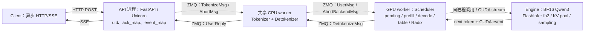

# Mini-SGLang I1：源码链路与运行手册

固定版本：[`sgl-project/mini-sglang@9a91cfa`](https://github.com/sgl-project/mini-sglang/tree/9a91cfafe754aa85daee49998176275667eb58f2)。
本机配置 TP1、`num_tokenizer=0`，tokenize 与 detokenize 共用一个 CPU 进程。
Engine 在 Scheduler 进程中；不能把图上的每个逻辑模块都算作一个进程。



`server/launch.py` 使用 multiprocessing spawn 启动 Scheduler 与 tokenizer worker，
通过 multiprocessing ack queue 等待就绪；另有 Python resource tracker 辅助进程。
`server/args.py` 在此配置下令 tokenizer 地址等于 detokenizer 地址。
`tokenizer/server.py` 接收三类消息，负责文本→IDs、IDs→增量文本和转发 abort。
`scheduler/scheduler.py` 决定 prefill/decode batch，`engine/engine.py` 执行模型与采样。

调度器持有 pending queue、running 集合、请求 table 和 prefix-cache handle。
GPU 内存属于 Scheduler/Engine 进程，HTTP 进程持有 UID 与输出缓冲。
TP1 仍初始化单 rank Gloo CPU process group；`distributed/impl.py` 的
`enable_pynccl_distributed` 在 size=1 时直接返回，本轮无多卡 NCCL collective。
TP2/4、rank 间广播和 NCCL trace 统一后期租卡验证。

观测边界：

| 事件 | 含义 | 不能推断的内容 |
|---|---|---|
| client queued | 到达后等待客户端 semaphore | 服务端排队时间 |
| http_headers | HTTP 已返回响应头 | 首 token 已算出 |
| scheduler_receive / UserMsg | Scheduler 已收到 tokenized 请求 | HTTP 接入队列长度 |
| batch_prepare / prefill | 请求开始进入 prefill batch 准备 | CUDA prefill kernel 完成时间 |
| batch_prepare / decode | 请求进入 decode batch | 独立 kernel 的执行时长 |
| scheduler_token | GPU 输出经 copy event 同步后提交的真实 token | 网络 frame 一定一 token |
| first_text | 客户端收到首个非空文本增量 | tokenizer 层面的精确 TTFT |
| request_free / scheduler_idle | table、KV handle 释放与缓存完整性 | reserved memory 应归零 |

控制面 host 时间来自同机 monotonic 时钟；记录中没有的独立 detokenize、网络单程、
GPU kernel duration 标为 unavailable。每步日志与 finite-logit 检查会扰动性能，
I1 不报告吞吐排名或在线 SLO。

从仓库根目录复现（模型先按 H1 固定 revision 准备好）：

```bash
git clone https://github.com/sgl-project/mini-sglang.git runs/vendor/mini-sglang
git -C runs/vendor/mini-sglang checkout 9a91cfafe754aa85daee49998176275667eb58f2
uv venv --python 3.11 runs/envs/mini-sglang
uv pip install --python runs/envs/mini-sglang/bin/python --torch-backend cu129 -r config/serving/i1_requirements.txt
runs/envs/mini-sglang/bin/python scripts/prepare_i1_toolchain.py
runs/envs/mini-sglang/bin/python -m unittest discover -s tests -p test_online_client.py -v
runs/envs/mini-sglang/bin/python scripts/run_i1_lifecycle.py --attempt local001
runs/envs/mini-sglang/bin/python scripts/audit_i1_lifecycle.py --directory results/i_minisglang/i1_lifecycle/local001
```

已有 clone/环境不必重建。工具链脚本针对本机 CUDA 13.0 的精确头文件形状，
其他硬件/SDK 应另立配置验证，不盲目套补丁。runner 会验证上游 commit 与干净工作区，
绑定 loopback、占用已有 GPU 全局锁、冻结源码/权重/依赖哈希；不可覆盖旧 attempt。
环境的 `bin` 必须在服务 PATH 中，CUDA_HOME 指向独立工具链副本。

检查 `run.json`、`requests.json`、`audit.json` 和按 PID 的本地日志；
客户端终态与服务端释放分别验收。worker 故障只终止本轮专用 GPU worker。
runner 最后向专用进程组发送 SIGINT，超过 10 秒强制回收，并记录是否强制、剩余 PID
和 GPU 占用；强制回收成功不算原生优雅关闭通过。该矩阵末尾含 worker 退出，
若需独立证明健康服务的优雅关闭，还须单独补测。

多卡任务保留在 H2/I2 待办。后期租卡前冻结同机 TP=1/2/4 配置、预算、准入检查、
NCCL/拓扑/每 rank 显存采集和关闭脚本；本地 smoke 不作为跨机速度比较的分母。
