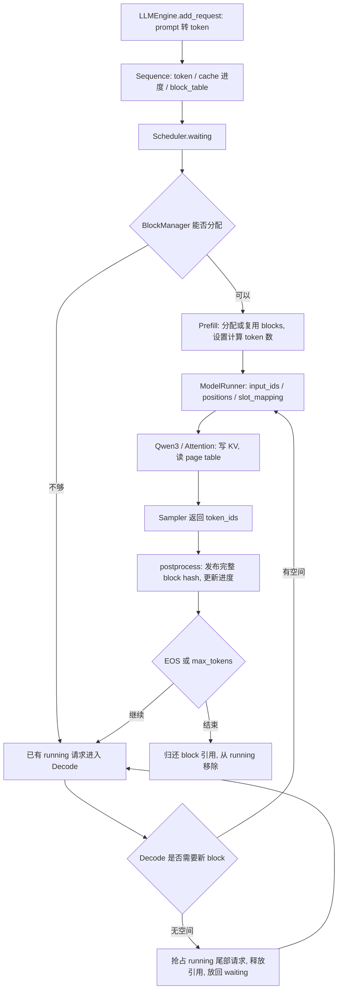

# nano-vLLM 源码阅读与 RouteScale 对照

此记录对应 commit `bb823b3e06983d71485a8e1f23715ebd87d98ef8`。
源码保存在 `runs/vendor/nano-vllm/`，测试入口为
[`serving/verify_nanovllm_state.py`](../serving/verify_nanovllm_state.py)。

## 请求从哪里进入 GPU

CPU 的 BlockManager 管理的是 block ID、引用计数、hash 和空闲队列；GPU 上的 K/V
tensor 由 ModelRunner 分配。二者通过 `block_table` 和 `slot_mapping` 关联：前者
告诉 attention 从哪些物理页读历史，后者告诉 KV writer 把本次 K/V 写到哪些槽位。

## 六个阅读停靠点

| 模块 | 应当能回答的问题 | 对应操作 |
|---|---|---|
| `engine/llm_engine.py` | 一批请求何时结束、输出如何恢复提交顺序？ | `add_request → step → generate` |
| `engine/scheduler.py` | 本轮做 Prefill 还是 Decode、谁被抢占？ | `schedule / preempt / postprocess` |
| `engine/sequence.py` | prompt、已有 KV、计划计算、已生成 token 各多少？ | `num_cached_tokens / num_scheduled_tokens / completion_token_ids` |
| `engine/block_manager.py` | 逻辑块落在哪个物理页、共享页何时可回收？ | `can_allocate / allocate / hash_blocks / deallocate` |
| `engine/model_runner.py` | token、位置与 GPU cache 地址如何组批？ | `prepare_prefill / prepare_decode / allocate_kv_cache` |
| `layers/attention.py` | KV 写入和 paged attention 谁执行？ | Triton `store_kvcache` 与 FlashAttention |

## 三条容易误解的状态规则

第一，prefix 命中不是“文本差不多”。完整 block 的 token IDs 与前一块 hash 一起计算
hash，命中后还核对 token IDs。相同片段若前文不同，不应复用相同 KV。
`can_allocate` 最多检查 `num_blocks - 1` 块，最后一块要计算，以便得到当前请求的 logits。
因此短于 256 tokens 的请求不会在这一路径获得 prefix block 命中。

这会直接影响与 G3 workload 的衔接：128-token prompt 的 75% 共享部分只有 96 tokens，
达不到一个 256-token block；512-token prompt 的共享部分为 384 tokens，才可能命中
至少一个完整 block。H2 应保留前者作为负对照，使用后者验证命中，并记录实际 cached
tokens，不能只依据“75% 共享”标签宣称复用收益。

第二，`ref_count=0` 不等于“KV 已擦除”。释放后，物理页回到 free 队列，hash 可以保留，
下一请求仍可能复活它。真正重新分配给其他内容时，旧 hash 映射才被移除。共享中的
block 要等所有请求释放引用才可回收，不能只看某个请求已完成。

第三，计算分块与内存分块不是同一件事。当前 commit 中的 chunked Prefill 会限制本轮
`num_scheduled_tokens`，但入场 `allocate` 仍为整个 prompt 分配逻辑块。未完成的 chunk
会更新缓存进度，但不会把本次采样结果追加为生成 token。只有最后一个 Prefill chunk
完成，序列才进入真正的生成阶段。该 scheduler 优先处理可入场的 waiting 请求，
并非 Prefill/Decode 在同一 GPU batch 中混合执行。

## 缓存不足时发生什么

Decode 在 block 边界需要追加物理页。空间不足时，scheduler 从 running 尾部选择请求，
执行 `preempt`：清空其 block_table、释放引用、重置 cached 进度并放回 waiting；已经生成
的 token 仍属于该序列，重新入场时要重算。若没有其他 running 请求可抢占，则抢占当前
序列。本项目状态测试直接构造三个物理页、两个跨边界请求，验证这一分支与资源守恒。

## 与 G 阶段的联系

G2 的连续 cache 为每个请求预留完整窗口；这里由 page table 将请求映射到共享物理池，
便于回收、调度和前缀共享。分页本身不保证更快，H2 仍需测量管理开销、有效 token 容量、
吞吐和延迟。

G3 的 RouteScale GPT 使用 learned absolute positions，超过 512-token 窗口后必须重建；
本阶段 Qwen3 使用 RoPE，二者模型结构、tokenizer、权重和 PyTorch 版本均不同，绝对
tokens/s 不构成同模型优化证据。H1 建立上游功能基线，H3 首轮已对 RouteScale 自身
权重完成正确性接入，详见下文；性能对照仍须另立合同。

最后，`SamplingParams` 在当前 commit 明确拒绝 temperature=0。H1 使用官方示例的
temperature=0.6 采样，因此文本能生成只证明链路运行；模型 logits 等价与正式消融应
另行验证。`enforce_eager=True` 也仅关闭 CUDA Graph：Sampler 与部分层仍使用编译。

## H2：Graph 究竟包住了什么

在 `ModelRunner.capture_cudagraph` 中，捕获的是
`outputs[:bs] = self.model(input_ids[:bs], positions[:bs])`，不是整个 LLMEngine：

| 工作 | 是否位于这个 CUDA Graph 内 |
|---|---|
| Prefill forward | 否，`run_model` 对 Prefill 直接走 eager 路径 |
| Decode 的模型 forward（含层内 attention/KV 写入） | 是，使用捕获的 batch size graph |
| scheduler、CPU 列表组批、输入张量准备与 graph buffer 拷贝 | 否 |
| `compute_logits`、Sampler、token `.tolist()`、postprocess | 否 |

因此应先观察 TPOT / E2E，再判断 Graph 是否减少了 Decode 的发射开销；不能把收益
解释为“所有算子计算量下降”或“TTFT 必然变快”。H2 记录的是主机可见离线批时延，
不是只计 `graph.replay()` 的微基准。Graph 的持久 buffer / pool 也要计入内存。
Graph 主要省去主机侧参数准备和 kernel dispatch 开销的机制说明，参见
[PyTorch 2.8 官方文档](https://docs.pytorch.org/docs/2.8/notes/cuda.html#why-cuda-graphs)。

## H2：状态、数值与性能是三道独立门槛

本轮真实遇到：Prefix admission 命中、28 层 KV 复用、引用回收全部正确，但原生 BF16
全模型 logits 未满足事前阈值。诊断发现第一层 Q/K/V 相同，attention 输出开始有
0.001953125 的差异；仅改为 FP32 attention 参考后，全模型跨路径 logits 差异归零。
详见 [H2 协议与证据](h2_ablation_protocol.md#prefix-cache-严格-gate-失败与定位2026-10-23)。

学习时分别回答三问：页地址和生命周期是否正确？相同输入的数值偏差是否在既定预算
内？通过这两项后，性能对照是否保持相同模型、请求和 KV 容量？不要用“能生成文本”
或“top-1 恰好一致”代替前两项，也不要把诊断用 FP32 路径的速度当成原生 BF16 结果。

后续两项数值问题已通过[显式 shape 策略](h2_numerical_fixes.md)修正：Graph / eager
使用相同页表宽度，Prefix off / on 都走 paged Prefill。原来仅切一个业务开关，却会
间接切换 kernel 分块或内核族；这会影响 BF16 舍入，不能默认所有差异都来自页地址。
新策略仍为 BF16，八个 case 全 64 步的 2,048 个全词表张量对照精确一致。
另一个学习点是调试本身也可能触发编译缓存上限、引入 eager fallback；因此最终验收
使用新进程、禁止静默回退、不带 debug copy，并与历史性能数据隔离。

新策略的[正式性能对照](../results/h_nanovllm/h2_corrected_pilot/README.md)已完成 36/36
进程：Graph 吞吐 5.90～7.47×，但并不普遍改善首 token；有效 Prefix 命中把 warm
TTFT 从 137.64 ms 降到 71.57 ms，却没有对应的整体吞吐收益。学习时应能从计时边界
解释：Graph 主要影响本机 Decode 执行开销，Prefix 复用减少 Prefill 工作，而固定
64-token 输出仍包含很长的 Decode。零命中负对照和固定物理 pool 也必须一起看。

后续[连续接入预检](../results/h_nanovllm/h2_scheduling/README.md)又说明另一层边界：
相同 attention 输出进入 `o_proj`，总 token 行数从 1024 变成 512，BF16 GEMM 也可能
出现舍入差异。本轮第一次分叉在投影层，而不是 attention；不能把不同实验中的
首个差异都归为缓存错误或沿用同一根因。孤立线性层分块精确，不等于全部模型已通过
跨调度验证。连续接入还应记录排队与真实 ITL，而不是把 TPOT 平均值当作逐 token 尾延迟。

后续[完整模型策略与实验](../results/h_nanovllm/h2_scheduling_tile512/README.md)把所有
112 个 Prefill 线性投影统一为相同的 512 行 BF16 GEMM，两侧同时应用、不填充假 token，
完整 1,664 个向量对照精确一致。18 个正式进程发现：补位提高混合请求吞吐约 32%，
但新 Prefill 让旧请求产生约 71～75 ms 的 ITL p99。因而“批更满”不等于“每个用户
输出更平滑”；下一步理解 Chunked Prefill / Overlap 时，应从这个可重现的干扰点出发，
而不是先假定这些开关一定有益。原失败源码已冻结，新策略的结果不冒充原生上游速度。

## H2：分页容量不是物理显存缩小，也不是吞吐

[容量与碎片实验](../results/h_nanovllm/h2_kv_capacity/README.md)在同一 896 MiB tensor
中比较固定预留和按需分页：128-token 当前 KV 能逻辑分配 8 / 32 个请求，但
PyTorch allocated memory 完全不变。原因是物理池早已申请；变化的是页的归属。
完整模型另以八请求跨过 256-token 边界，1056 个全词表向量全部 exact，并不意味
32 请求的并发生成已经验收。

阅读 `BlockManager.may_append`、`Sequence.num_blocks`、`prepare_decode` 时追踪：
当前 token 位于哪一页？增长时有没有空闲页？释放是否归还整项预留？本轮静态预留
adapter 私有保存未来页，实际页表只包含当前页；否则 `block_table[-1]` 会把 Decode
写到未来页。分页在洞间复用不需要连续大区间，但 257-token 请求会浪费 255 个槽。
固定预留空闲、页尾浪费和连续外部空洞是三个独立量；CPU 精确连续参考在无空洞时
还可能比分页放下更多请求。下一步 KV 压力实验应从真实峰值增长预算设计，不从
“分页一定省显存、一定更快”的前提出发。

## H2：什么时候预留优化会变成真实吞吐

[真实 KV 配额实验](../results/h_nanovllm/h2_kv_pressure/README.md)保持模型、请求、
attention、Graph 与调度策略相同，只改变预留/接入。448 MiB 池下，固定窗口每批
只能资助四请求，分页可资助八请求；真实完整请求吞吐为 1.950× / 1.887×，而不是
将分配器的槽数比直接当成速度比。大批次也使 TPOT 略差、激活峰值增加约 18 MiB。

分页接入的检查是“当前 KV + 未来增长”的预算，而不仅是 prompt 刚好放得下。
132 个输出对应最后 259 个 KV tokens，实际八请求从八页增长到十六页仍完成；
最后一个采样 token 尚未进入下次 forward，所以 off-by-one 会影响边界资助。
这一跨批形状 scope 又单独通过 4,160 个完整向量 exact 门禁，未直接沿用旧 gate。

充裕预算时，两侧都能接入八请求，分页却只有 0.931× 吞吐。调用结构与采样输出
相同、编译计数不变，也不能仅凭这些条件排除页地址局部性、设备状态或主机调度
影响；wall-time 时间边界不等于 kernel 时间。保留负结果并继续定位，比从较少
已用页推出“必然加速”更重要。该受控 KV 配额实验没有耗尽整卡显存。

## H2：把不稳定退化与固定布局开销分开

[后续诊断](../results/h_nanovllm/h2_kv_diagnostic/README.md)没有先改 allocator，
而是复用原完整请求执行函数，在同一模型进程中 ABBA/BAAB 平衡交替；另外统一
分配器、仅变当前页号，把页地址作用与额外预留/接入工作分开。数值探针、真实
sampler 请求计时、无 sampler 的 CUDA stream 计时各有独立证据类型。

48 条完整请求配对 trace 的进程级中位比为 1.017×，未复现原 0.931×；三种页布局
Decode stream 中位差约 1%，部分 Prefill 差异仍存在。3072 个完整向量 exact 和
引用释放通过说明覆盖输入的正确性，不说明所有地址/主机/设备成本都相同。
不能拿新的配对比替换旧正式数据，也不能仅凭更充分共同预热后的复测就断言旧
结果一定是噪声或只由预热造成。历史缺少 trace 内遥测，唯一系统根因仍未确认。

## H3：换执行框架不等于换模型结构

[本项目接入](h3_routescale_protocol.md)把学习从 Qwen 示例推进到自己的训练权重。
沿着三个文件阅读即可对照各自职责：

- [`h3_prepare.py`](../serving/h3_prepare.py)：原 GPT-2 字节/rank 表如何变成 serving
  环境可用的离线 tokenizer，怎样避免改坏原环境和输入 IDs。
- [`h3_model.py`](../serving/h3_model.py)：不等长请求如何 packed；每请求 position
  如何独立编号；怎样保留 wte+wpe、LayerNorm、GELU 和 tied LM head，只替换 attention。
- [`routescale_nanovllm.py`](../serving/backends/routescale_nanovllm.py)：为什么必须
  绕开硬编码 Qwen 的初始化，以及哪些上游调度/分页/Graph 方法仍可原样复用。

正确性链分为 FP32 结构映射、同权重 BF16 全步参考、Graph exact 与资源生命周期，
不能把其中一层当成全部通过。Prefix 命中不需要 RoPE，但 learned absolute position
要求同 token 前文对应同位置；本轮只复用完整同前缀页，并拒绝超 512 的缓存预算，
没有直接搬用 G3 的滑窗重建语义。

本轮 792 个 native-BF16 向量通过、264 个 eager/Graph 向量 exact，说明上游能力已
实际作用于本项目权重，不说明已有速度收益。特别注意 G3 的 autocast 与 H3 的全
BF16 权重并非同一精度合同，不能把历史耗时横着相除。完整证据见
[`H3 结果`](../results/h_nanovllm/h3_routescale/README.md)。

固定源码：[LLMEngine](https://github.com/GeeeekExplorer/nano-vllm/blob/bb823b3e06983d71485a8e1f23715ebd87d98ef8/nanovllm/engine/llm_engine.py)、
[BlockManager](https://github.com/GeeeekExplorer/nano-vllm/blob/bb823b3e06983d71485a8e1f23715ebd87d98ef8/nanovllm/engine/block_manager.py)、
[Scheduler](https://github.com/GeeeekExplorer/nano-vllm/blob/bb823b3e06983d71485a8e1f23715ebd87d98ef8/nanovllm/engine/scheduler.py)。
