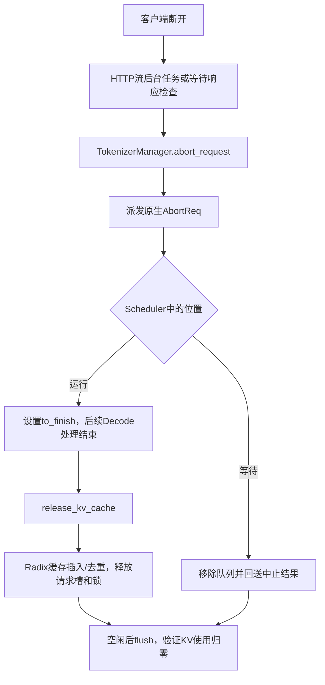

# SGLang0.5.20：取消、队列与 KV 释放

固定源 commit `94602c9c2b7cbdb8efd5c52802dac6a1c180089e`。
[关键源码清单](../deploy/local/sglang/upstream_sources.json)绑定19文件SHA，doctor核对
已安装wheel与干净上游源码相同。以下路径针对本轮TP1、UnifiedRadixCache的FULL组件、无PD分离和无Mamba；
不把其他分支的释放语义移植到本配置。

原生入口 [serving_completions.py](https://github.com/sgl-project/sglang/blob/94602c9c2b7cbdb8efd5c52802dac6a1c180089e/python/sglang/srt/entrypoints/openai/serving_completions.py#L194)
在发送HTTP200前先推进生成器做验证，再构造 StreamingResponse，并设置
TokenizerManager.create_abort_task。后台任务等待2秒后，若RID仍在状态表中就发中止。
尚未产生第一帧的等待请求由
[_stream_one_response](https://github.com/sgl-project/sglang/blob/94602c9c2b7cbdb8efd5c52802dac6a1c180089e/python/sglang/srt/managers/tokenizer_manager.py#L1824)
按状态等待超时检查客户端是否断开，默认等待间隔4秒。客户端deadline结束不表示后端
在同一时刻结束；本轮另保存原生abort、queue和KV观测。

[TokenizerManager.abort_request](https://github.com/sgl-project/sglang/blob/94602c9c2b7cbdb8efd5c52802dac6a1c180089e/python/sglang/srt/managers/tokenizer_manager.py#L2093)
忽略未指定abort_all的空RID，以免startswith匹配全部请求；同一ReqState用abort_sent
避免重复派发，再将AbortReq送入scheduler，原生aborted计数在这一边界增加。
因此aborted不是“GPU已释放”计数，也不能与processed简单相减计算客户端成功。

[Scheduler.abort_request](https://github.com/sgl-project/sglang/blob/94602c9c2b7cbdb8efd5c52802dac6a1c180089e/python/sglang/srt/managers/scheduler.py#L5217)
区分等待与运行请求。普通等待请求尚未分配KV，从waiting_queue移除后仍需把中止结果
发回tokenizer完成状态清理。运行请求设置FINISH_ABORT到to_finish，经后续输出处理
结束，而非在接收AbortReq时直接回收仍可能被GPU使用的页。

[batch_result_processor.py](https://github.com/sgl-project/sglang/blob/94602c9c2b7cbdb8efd5c52802dac6a1c180089e/python/sglang/srt/managers/scheduler_components/batch_result_processor.py#L1310)
在req.finished()后进入release_kv_cache。
[mem_cache/common.py](https://github.com/sgl-project/sglang/blob/94602c9c2b7cbdb8efd5c52802dac6a1c180089e/python/sglang/srt/mem_cache/common.py#L276)
先处理cache_finished_req、越界预分配的尾页，再释放req_to_token_pool请求槽并标记
KV已释放。[UnifiedRadixCache.cache_finished_req](https://github.com/sgl-project/sglang/blob/94602c9c2b7cbdb8efd5c52802dac6a1c180089e/python/sglang/srt/mem_cache/unified_radix_cache.py#L959)
实际初始化日志指明impl=UnifiedRadixCache，FULL组件走统一树实现。它可能将前缀留下以供复用，释放重复页/未对齐尾部，解除请求前缀锁并完成component清理。
因此客户端结束后GPU显存池不下降、前缀仍可复用，都不能单独判定为泄漏。

本轮最小问题复现为：观察4个原生running请求，另一个明确RID实际入队；关闭该客户端
后显式调用原生 `/abort_request`，保存两个动作及在blockers仍运行时queue归零的证据。
显式中止不冒称自动断开处理。独立断开和客户端deadline场景则等待原生路径自行清理。
最终待running/queue都为0，原生flush成功，再核对KV指标，避免仅凭HTTP终态下结论。
重放入口见 [check_framework.py](../scripts/check_framework.py)，每次使用新目录。

容器随后复现了另一个观测边界：`/v1/loads`读取共享快照，
[publish_load_snapshot](https://github.com/sgl-project/sglang/blob/94602c9c2b7cbdb8efd5c52802dac6a1c180089e/python/sglang/srt/managers/scheduler.py#L863)
按scheduler迭代计数节流，GET不等于即时重新采样。显式预热通过后，0.7秒内仍多次
读到同一timestamp，所以不能用该短窗口证明请求没有排队。新的
[容器握手范围](sglang_container_protocol.md)先观测真实queue，再关闭HTTP连接；
保持原256token阻塞请求；900token夹具超过正式30秒预算的失败也保留。客户端门控另有真实异步流CPU测试，
覆盖关闭、自然完成与deadline，防止仅取消观察任务而没有关闭连接。

另一个实际问题是flush后的可观测性：固定版本的空闲reporter按30秒节流，flush返回成功
后15秒内仍可能读到上一个batch的KV使用103/可用3993。首次真实失败保存在
[原始证据](../results/delivery/local_v1/sglang_failed_idle_metrics/run.json)，不改写为通过。
[成功flush观测补丁](../serving/framework_flush_metrics.py)先执行原生flush；只有成功
才触发原生idle reporter重新采样，再从pool_stats_observer输出实际池状态。原生wheel
文件不改，补丁在父进程和spawn的scheduler中显式安装。CPU反例保留非零used=7、
available=100、evictable=12、capacity=119，证明不会写死零；失败flush不刷新。
真实验收把每次HTTP flush的单调时间窗口、原生池事件与Prometheus指标三方核对。

客户端适配 [CompletionClient](../serving/framework_client.py)保持原生完成接口、
原prompt和全部原生SSE帧不变，映射choices.text到既有M3/I3事件读取器，使两个框架能
用同一客户端状态/时间边界观察。CPU测试覆盖正常原生流、截断流、错误schema及文本帧
保真；真实验收逐请求重开原生帧并重建文本，与客户端账本核对。它不修改上游计算，
也不把连接首帧当GPU运行起点。指标解析与可选账本显示的测试另防止将processed误称成功。
