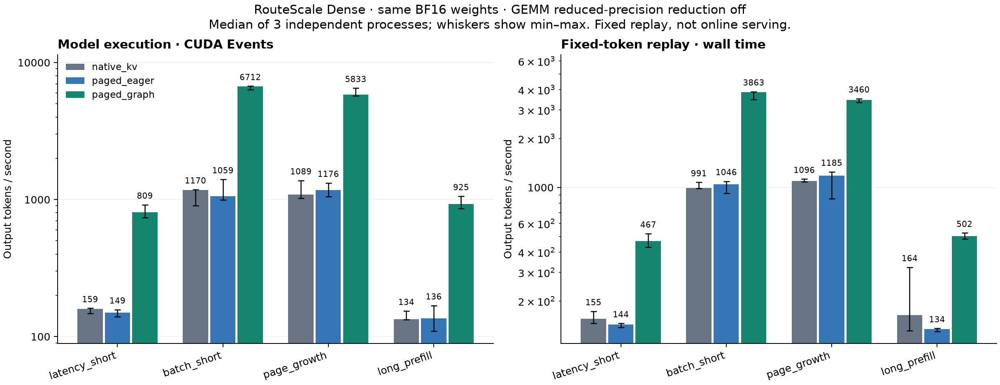

# H3：同模型受控性能矩阵与计时波动复核

日期：2026-10-24（北京时间）。**36/36 正式进程完成，数值资格与独立文件／指标审计通过。**
这是明确数值策略下的离线固定 token 回放；部分计时波动较大，尚不能当作稳定的性能排名。
H2 多卡 TP、自然生成 API 和在线服务仍不在本轮范围。

## 做了什么

同一个 RouteScale TinyStories Dense artifact、同一张 RTX 5060 Laptop GPU、同一
serving 环境（Python 3.11.16 / PyTorch 2.8.0+cu129 / FlashAttention 2.8.3.post2），
比较 native 连续 KV eager、分页 eager、分页 Decode Graph。模型权重和实际输入／输出
全部 BF16，Prefix off，TP=1，保留 learned absolute positions、LayerNorm/GELU 和 tied weights。

三侧共同关闭 BF16 GEMM 中间累积降精度许可，即
`torch.backends.cuda.matmul.allow_bf16_reduced_precision_reduction=False`。
这是显式数值策略，不是原默认策略的排名。没有改训练权重、旧代码、原环境依赖或上游 checkout。

数值参考将**已经舍入为 BF16 的同值参数**提升到 FP32，逐请求 full recompute，强制
math SDPA 并关闭 TF32。2592 个 BF16 全步全词表目标向量相对该数学参考全部满足
原 `atol=0.125, rtol=0.02` 和 relative RMSE≤0.5%，最坏为 **0.430108%**；
864 个 eager/Graph 向量 bitwise exact。FP32 参考不参与性能计时。

配置：[h3_performance_v5.json](../../../config/serving/h3_performance_v5.json)；
完整合同：[v5 协议](../../../docs/h3_performance_v5_protocol.md)；
输入与计时定义：[基础协议](../../../docs/h3_performance_protocol.md)。

## 观测结果

下表为各进程五次测量的中位数，再取三个独立进程中位数。
`replay_e2e` 包含入队／cohort、组批、H2D、模型、argmax、CPU 交接与回收；
后续输入使用冻结的 validation token。它不是上游公共 `generate()`、文本／网络耗时或在线 SLO。

| case（B / prompt / output） | native KV token/s | paged eager token/s | paged Graph token/s | Graph/eager 中位数比 |
|---|---:|---:|---:|---:|
| latency_short（1 / 32 / 32） | 155.1 | 143.7 | 467.2 | 3.25× |
| batch_short（8 / 128 / 64） | 990.9 | 1046.1 | 3862.9 | 3.69× |
| page_growth（8 / 255 / 32） | 1096.3 | 1185.3 | 3459.8 | 2.92× |
| long_prefill（1 / 384 / 64） | 163.6 | 134.2 | 502.3 | 3.74× |

在这些样本中，Graph 的回放吞吐高于 eager，收益主要体现于 Decode。Graph 的
TTFT 为 13.11–14.44 ms，未优于两条 eager 路径；Prefill 不在 Decode Graph 中，
同时存在计时波动，不能仅凭这张表认定 Graph 导致 Prefill 变慢。
分页 eager/native 的吞吐比为 0.82–1.08，存在负结果；两者同时改变 attention
实现、布局与 CPU 控制，不能将全部差异归因于分页。

native 实际 KV 分配 B=1 为 8 MiB、B=8 为 64 MiB；分页物理池始终为 64 MiB。
本轮 Graph 相对分页 eager 的峰值 allocated 增加约 8.1 MiB。未搜索整卡最大容量。



[完整延迟、显存和初始化表](tables.md)、[汇总 JSON](summary.json)、[SVG](throughput.svg)。
两种计时范围单独呈现：`model_execution` 为 CUDA Event 模型调用区间，包含可能的
提交空隙，不等同于 Profiler 的 kernel busy-time。两种范围分别运行，不能交叉相除求框架加速比。

## 计时稳定性限制与追加诊断

六个预声明 pilot 均通过，最大 CV 为 13.88%，低于 15%。正式矩阵仍观察到波动：

- long_prefill/native 的三个进程回放吞吐为 163.6、322.7、131.1 token/s，最大／最小为 **2.46×**。
- 72 个「进程×计时范围」中，有 18 个的 CV 超过 pilot 使用的 15%；最高为 36.41%。
- 全部运行均保留。图中误差线展示独立进程最小／最大值；这些中位数比不是置信区间或稳定收益承诺。

随后限定追加三组新进程，组内轮转三条路径，只测 long_prefill 回放 E2E。
该配对诊断的 Graph/native 吞吐比为 2.97、5.35、5.67；Graph/eager 为 3.41、3.99、4.70。
收益方向在这些样本中仍一致，但幅度不稳定，其中一组 Graph 的波内 CV 达 32.7%。
GPU 起止快照出现 P0/P4 与不同显存时钟，未修改电源或频率设置；少量快照不足以
唯一确定历史原因。**计时稳定性仍需在更受控的运行环境中复验。**

诊断独立保存在 [timing_diagnostic/summary.json](timing_diagnostic/summary.json)，
不替换原 36 个正式进程或其汇总。诊断执行源码副本见 `timing_diagnostic/source_snapshot/`。
逐进程质量标注见 [measurement_quality.json](measurement_quality.json)，
可导出的逐进程表见 [per_process_timing.csv](per_process_timing.csv)。

## 数值失败历史与结论边界

v1–v5 的请求与后续 token 文件字节完全相同，没有挑选新的输入以通过门槛：

| 范围 | 数值口径／策略 | 结果 |
|---|---|---|
| [v1](../h3_performance_v1/README.md) | 默认累积，batched BF16 参考 | 分页 batch_short 0.556876%，fail；正式 0/36 |
| [v2](../h3_performance_v2/README.md) | 默认累积，逐请求 BF16 参考 | native page_growth 0.524697%，fail；正式 0/36 |
| [v3](../h3_performance_v3/README.md) | 默认累积，FP32 数学参考 | native/page_growth 0.530423%、paged/batch_short 0.514894%，fail；正式 0/36 |
| [v4](../h3_performance_v4/README.md) | 禁止中间累积降精度，三参考同时要求通过 | 数学参考与批量 BF16 参考通过；逐请求 BF16 互比最高 0.570047%，联合 gate fail；正式 0/36 |
| v5 | 同一累积控制，沿用 v3 的 FP32 数学预算 | 数值 gate、6/6 pilot、36/36 正式与独立审计通过；计时稳定性限制保留 |

诊断先在第一层 MLP c_proj 输出观察到 batch/slice 差异。固定相同 BF16 输入与权重，
关闭降精度许可后，不同元素数从 210339 降至 422，两个失败目标相对数学基准的误差下降。
该证据支持 GEMM 累积策略是重要变量，不是 attention/KV/Graph bug 已被普遍修复的证明。

本轮 pass 证明各目标相对数学参考满足预算，**不证明任意两个 BF16 舍入路径之间也满足
同一个 0.5% 阈值**。v1–v4 的失败原样保留。没有自然生成质量、公共文本 API、超窗口、
多卡、在线尾延迟、最大并发或默认配置普遍加速结论。

## 复核、文件与后续

- [gate.json](gate.json)：2592 个目标向量和 864 个 Graph exact 向量。
- [pilot_gate.json](pilot_gate.json)：六个进程的预声明稳定性／资源门槛。
- [run.json](run.json)、`raw/`：36 个独立正式进程、两种计时范围、逐轮与逐 token 原始值。
- [audit.json](audit.json)：新进程重算全部数值比较与指标、验证源码／配置／权重／参考／raw 哈希。
- [historical_baseline.json](historical_baseline.json)：本轮开始前所有旧 G/H JSON 哈希；结束和独立审计均核对一致。
- `source_snapshot/`：执行时冻结的源码、配置和协议。

两种测量范围分别执行，共 1620 个请求预算、77760 个输出位置，不含预热；这不是
77760 个自然采样 token 的生成质量证据。CPU 回归共 185 项，183 通过，2 项 CUDA 测试
因显式禁用 CUDA 跳过；真实 GPU 数值与计时另行执行。

```bash
# 只读复核，不重跑或覆盖正式记录。
runs/envs/nano-vllm/bin/python scripts/audit_h3_performance.py --config config/serving/h3_performance_v5.json --check-only

# 图表在独立报告环境生成，不修改 serving 环境。
UV_CACHE_DIR="$PWD/runs/cache/h3_report_uv" uv run --isolated --no-project --python 3.11 --with matplotlib==3.11.2 scripts/plot_h3_performance.py --directory results/h_nanovllm/h3_performance_v5

# 从已审计原始值重建计时质量标注与 CSV，不覆盖实验数据。
.venv/bin/python scripts/annotate_h3_performance.py --config config/serving/h3_performance_v5.json
```

大 logits、请求数组、编译缓存与日志分别位于 `runs/validation/h3_performance_v5/`、
`runs/workloads/h3_performance_v5/`、`runs/cache/h3_performance_v5/`、
`runs/logs/h_nanovllm/h3_performance_v5/`。图表环境与输入哈希见 [plot_provenance.json](plot_provenance.json)。

本轮已完成受控矩阵执行与复核，稳定性能幅度仍待复验。下一步可推进 I1 的服务链路
正确性／取消／资源回收，不能用本轮的绝对吞吐直接制定在线 SLO；H2 多卡 TP 另列待办。
