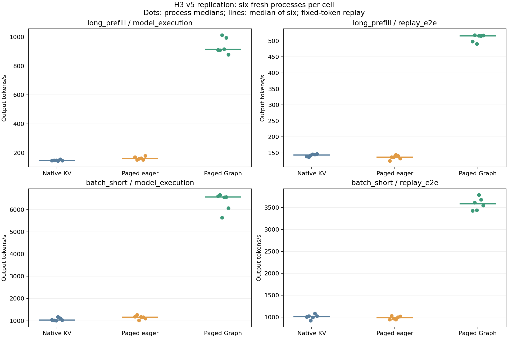
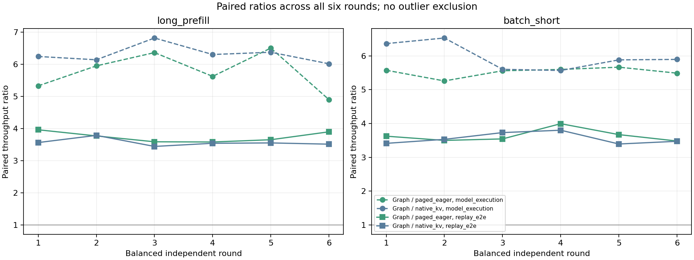

# H3 v5 计时稳定性复验

2026-11-02：**本机稳定性调查已完成并验收，整体稳定性标准仍未达到。**
[最终验收](acceptance.json)的11项工程检查、[独立审计](audit.json)的301项检查全部通过。
36/36个正式新进程、1440个测量波和1440个预热波完整保留；23项CPU测试通过。
六进程中位吞吐的跨进程范围已明显收窄，但17/72个「进程×计时范围」仍有CV>15%。
不能将调查完成解释为稳定性能幅度已被证明。

本轮只复验预选的long_prefill与batch_short；latency_short、page_growth的历史计时
没有在本轮重跑。原[v5报告](../h3_performance_v5/README.md)、36个正式进程、三次追加
诊断和v1–v4数值失败全部保留。1446份既有G/H/I JSON起点哈希见[historical.json](historical.json)，
结束时全部一致。本轮未使用付费资源，GPU最终0 MiB / 0%，40个检查/资格/正式子进程
均正常退出，无超时、信号升级或残留。

## 保持的计算与重新验证的资格

同一RouteScale TinyStories Dense artifact、RTX5060 Laptop GPU、原nano-vLLM pinned
checkout；Python3.11.16、Torch2.8.0+cu129、FlashAttention2.8.3.post2，driver610.88。
三条路径仍为native连续KV、paged eager、paged Decode Graph，BF16输入/权重/输出、
Prefix off、TP1、64MiB分页池；共同关闭BF16中间累积降精度许可。
原计算源码、v5配置、请求数组、固定continuation、run_wave及误差门槛均未修改。
见[新协议](../../../docs/h3_stability_protocol.md)、[配置](../../../config/serving/h3_stability_v1.json)
及[28份执行源快照的绑定](provenance.json)。

先在新进程只读重开原v5的2592个数值向量、864个eager/Graph exact向量及原36进程
审计，全部复现。随后三个新资格进程分别重建两case、毒化KV并重新收集全步全词表
logits：1728/1728向量满足原BF16权重提升至FP32数学参考的
`atol=.125, rtol=.02, relative_RMSE<=.005`，最坏0.430108%；其中576个
paged eager/Graph向量bitwise exact。资格审计重新打开新张量与原FP32参考，不仅
检查pass标志。正式进程的权重、输入、精度、Graph keys和实际argmax均绑定新资格。
[新资格门槛](qualification_gate.json)22项通过，未将旧通过项冒充新采集向量。

## 测量合同与完整性

| case | batch | prompt | output上限 |
| --- | ---: | ---: | ---: |
| long_prefill | 1 | 384 | 64 |
| batch_short | 8 | 128 | 64 |

每case/路径有六个独立进程；六轮采用六种路径排列，每路径在每位置出现两次，
同时交替case和scope先后顺序。每个scope固定预热20波、测量20波，不按结果延长
预热、不删异常波、不挑有利重跑。完整顺序见[plan.json](plan.json)，退出与日志哈希见
[processes.json](processes.json)。1440个测量波对应6480个请求预算、414720个固定
输出位置；它们是离线受控回放，不是自然生成质量证据，也不是6480个独立性能样本。

`model_execution`仍为CUDA Event模型调用区间，可能包含CPU提交空隙，不等于
kernel busy-time。`replay_e2e`包含共同控制harness、H2D、argmax、CPU交接与回收。
两个scope分别执行，不交叉相除；初始化/Graph捕获、预热和传感器采集不进入测量。

每个进程先取20个测量波的中位吞吐，再对六进程取中位数。表中的min/max是六个
进程中位数的范围，不是置信区间。配对比按同轮同scope计算后取六轮中位数，
不会用两格中位数相除冒充配对统计，也不将120波当成120个独立进程。

## 全部十二格结果

最大CV同时检查该scope的wall与measurement时间；model_execution两者可能不同。
格内稳定需全部六进程CV<=15%且六进程中位吞吐max/min<=1.25。

| case | 范围 | 路径 | 输出token/s中位（六进程范围） | max/min | 最大波内CV | 格内稳定 |
| --- | --- | --- | ---: | ---: | ---: | --- |
| long_prefill | model_execution | native_kv | 146.91（145.35–155.99） | 1.073 | 22.08% | 未通过 |
| long_prefill | model_execution | paged_eager | 160.99（152.69–179.08） | 1.173 | 16.22% | 未通过 |
| long_prefill | model_execution | paged_graph | 913.62（877.79–1012.41） | 1.153 | 50.87% | 未通过 |
| long_prefill | replay_e2e | native_kv | 143.65（136.63–147.09） | 1.077 | 18.35% | 未通过 |
| long_prefill | replay_e2e | paged_eager | 136.96（125.64–144.07） | 1.147 | 13.21% | 通过 |
| long_prefill | replay_e2e | paged_graph | 515.60（490.70–517.71） | 1.055 | 9.97% | 通过 |
| batch_short | model_execution | native_kv | 1033.74（1006.84–1177.82） | 1.170 | 18.81% | 未通过 |
| batch_short | model_execution | paged_eager | 1165.05（1014.58–1265.34） | 1.247 | 14.65% | 通过 |
| batch_short | model_execution | paged_graph | 6563.19（5642.17–6655.92） | 1.180 | 39.08% | 未通过 |
| batch_short | replay_e2e | native_kv | 1013.37（922.04–1084.01） | 1.176 | 33.65% | 未通过 |
| batch_short | replay_e2e | paged_eager | 986.37（945.53–1032.96） | 1.092 | 16.66% | 未通过 |
| batch_short | replay_e2e | paged_graph | 3584.73（3428.76–3788.46） | 1.105 | 16.13% | 未通过 |

全部12格的跨进程max/min均<=1.247，满足预声明1.25界限。long_prefill/native
replay_e2e为1.077，相比历史三进程2.46更集中；但这同时改变了预热/测量次数、
顺序和运行日期，没有隔离单一因果，不把改善唯一归因于预热或电源状态。

只有3/12格通过完整格内标准；17/72个进程scope仍有波内CV>15%。最突出的是
long_prefill/Graph/run5的model_execution：wall CV50.87%、CUDA Event总量CV43.92%；
batch_short/Graph/run3分别为39.08%/33.05%。这些长尾全部保留。跨进程中位数收窄
没有消除单波抖动；原v5的72行包含四case，而本轮72行来自两case六进程，不能直接
用两轮超标行数之差声称方差下降。

## 配对收益与负结果

| case | 范围 | Graph相对路径 | 六轮配对比中位（范围） | 配对比CV |
| --- | --- | --- | ---: | ---: |
| long_prefill | model_execution | paged_eager | 5.790（4.902–6.508） | 9.73% |
| long_prefill | model_execution | native_kv | 6.277（6.018–6.821） | 4.00% |
| long_prefill | replay_e2e | paged_eager | 3.713（3.583–3.964） | 3.95% |
| long_prefill | replay_e2e | native_kv | 3.549（3.445–3.789） | 2.97% |
| batch_short | model_execution | paged_eager | 5.569（5.260–5.667） | 2.35% |
| batch_short | model_execution | native_kv | 5.890（5.570–6.530） | 6.02% |
| batch_short | replay_e2e | paged_eager | 3.586（3.483–3.995） | 4.77% |
| batch_short | replay_e2e | native_kv | 3.504（3.395–3.803） | 4.37% |

全部12种配对比较的比值CV均<=15%，Graph的八项比较在六轮中方向均一致。
这些是本轮有限样本的描述；由于格内稳定仍失败，不外推为精确稳态加速比或生产承诺。
本轮E2E的Graph/eager配对比中位约3.71（long_prefill）和3.59（batch_short）。
paged eager/native的E2E配对比中位只有.966/.975，范围均跨过1，分页eager本身
没有稳定吞吐优势；不能把attention实现、布局与CPU控制的共同差异全部归给分页。

| case | 路径 | replay TTFT ms | replay TPOT ms |
| --- | --- | ---: | ---: |
| long_prefill | native_kv | 6.66 | 6.94 |
| long_prefill | paged_eager | 9.73 | 7.25 |
| long_prefill | paged_graph | 12.70 | 1.76 |
| batch_short | native_kv | 8.27 | 7.87 |
| batch_short | paged_eager | 10.32 | 8.05 |
| batch_short | paged_graph | 14.27 | 2.06 |

Graph主要改善decode，首结果并未改善；prefill不在Decode Graph内，不将这里的
TTFT差异归因成Graph单独导致prefill变慢。这里的TTFT也不是HTTP文本首字延迟。
所有ITL p50/p95/p99保留在CSV/JSON；少量受控回放的经验p99不代表线上尾延迟。

## 环境观测与根因限制

432份离散窗口外快照中：温度45–57°C，SM时钟1642–2820MHz，显存时钟
9001–12101MHz，功耗10.63–53.58W，P0/P2/P4分别138/156/138次；交流供电始终在线。
GPU power.limit字段432次均为`[N/A]`，没有虚构功率上限。CPU一分钟load为1.05–1.52。
未改系统频率/电源设置，也未在计时区间启动nvidia-smi。

采样位于预热前/后和每5个测量波之后；采样间歇可能影响后续频率与缓存状态，
不能将快照当连续kernel遥测。快照确实显示多种状态，但不足以确定历史波动唯一原因，
也没有证明某次长尾必由降频或温度触发。现阶段保留“收益方向一致、进程中位数
更集中、单波抖动未解决”的结论，不继续无界挑选重跑以获得漂亮CV。

## 图表、复核与范围




五份CSV分别为[72行进程scope](processes.csv)、[12格统计](statistics.csv)、
[12项配对比较](comparisons.csv)、[2880行预热/测量波](waves.csv)和
[432行传感器](sensors.csv)。图另有同名SVG，所有导出哈希见[export.json](export.json)。
23项CPU检查（新12项+原H3 performance11项）见[cpu_tests.json](cpu_tests.json)及
[原始测试日志](cpu_tests.txt)，覆盖顺序平衡、计时分母、缺失/重复进程、保留异常、
准入失败/陈旧源负对照及原数值/页增长/回收合同。

独立总审计重开全部新数值及参考、重算36进程所有测量/预热trace与资源合同、
argmax、统计、执行顺序、传感器位置、进程退出、源码和历史证据哈希。验收字段
`local_timing_investigation_complete=true`与`timing_stable=false`明确分别保存。
Git包含紧凑trace、源快照与证据；大logits、模型、数据、依赖和执行日志仍在ignored
runtime。仅克隆Git不能重开这些大文件，需要恢复相同原始文件和锁定环境。

本次实际执行顺序（已有目录拒绝覆盖）：

```bash
.venv/bin/python scripts/run_h3_stability.py --stage qualification
OMP_NUM_THREADS=4 MKL_NUM_THREADS=4 runs/envs/nano-vllm/bin/python scripts/audit_h3_stability.py --stage qualification
OMP_NUM_THREADS=4 MKL_NUM_THREADS=4 runs/envs/nano-vllm/bin/python scripts/run_h3_stability.py --stage measurement
OMP_NUM_THREADS=4 MKL_NUM_THREADS=4 runs/envs/nano-vllm/bin/python scripts/audit_h3_stability.py --stage final
runs/envs/i2-report/bin/python scripts/export_h3_stability.py
runs/envs/nano-vllm/bin/python scripts/accept_h3_stability.py
```

首步要求当前CPU证据，日志/命令/source SHA已归档。现有数据只读重算：

```bash
OMP_NUM_THREADS=4 MKL_NUM_THREADS=4 runs/envs/nano-vllm/bin/python scripts/audit_h3_stability.py --stage final --check-only
```

本轮未重做完整四case排名、默认BF16数学、自然生成、公共API、长期稳态或多卡。
H3这项有界复验调查结束，精确稳态加速幅度仍缺证据。下一本机任务是完整框架交付
与TP配置/验收脚本准备；TP2/4集中租用仍后置，付费资源尚未授权。个人复盘、面试
指南和知识验收继续留待全部实验完成后统一整理。
