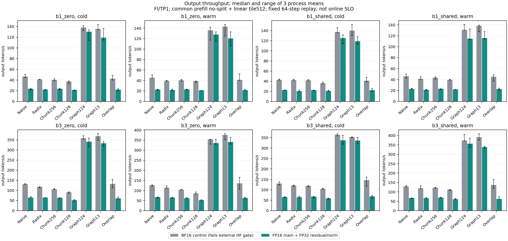
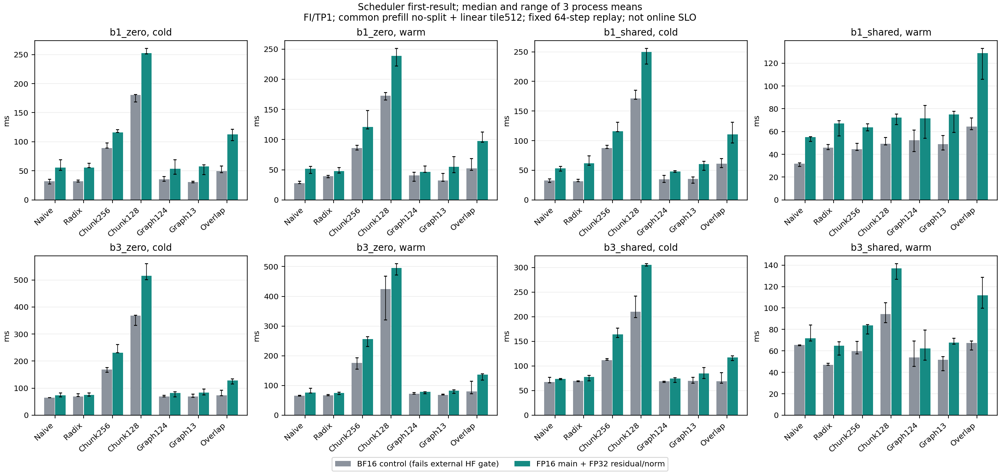
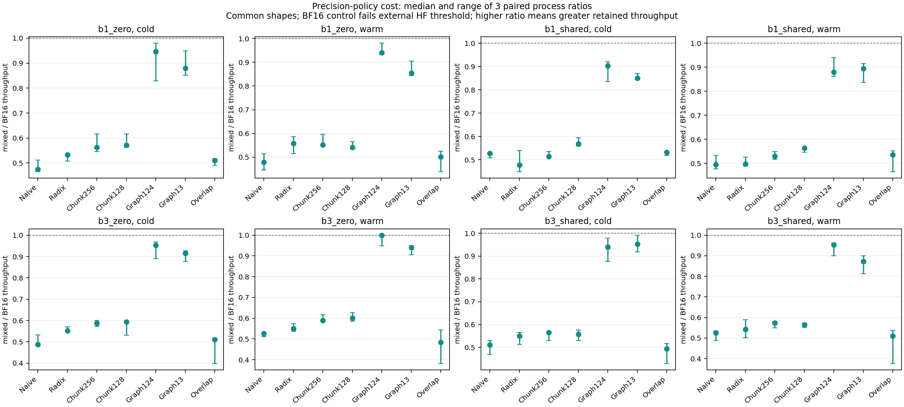

# I2 新精度七配置与本机最终验收

2026-11-01：**I2 本机 FI/TP1 最终验收完成。**
[最终验收](acceptance.json)绑定数值、真实 HTTP、关闭预算、42 次正式进程、
20 项 CPU 检查及全部导出哈希；[独立性能审计](perf001/audit.json)的 347 项
检查全部通过。最终 GPU 为 0 MiB / 0%，无本任务进程残留。
本轮未进入 I3，未使用付费资源；TP2/4 仍按计划后置。

协议见 [冻结数值与计时协议](../../../docs/i2_precision_protocol.md)，重试入口与
服务关闭策略见 [补充说明](../../../docs/i2_precision_retries.md)。原 BF16 对
HF FP32 的失败及此前性能结果均保持原范围，不重写为通过。

## 已验收的数值结果

[qual001/audit.json](qual001/audit.json) 独立重新打开全词表张量，复算全部
25088 个目标向量及原始输入、模型、源码、Graph 捕获、实际执行与资源检查。
16 个独立进程正常结束：两种新参考与两种模式各七配置。

| 模式 | 参考与结果 | 最坏相对 RMSE |
| --- | --- | ---: |
| mixed | 七配置共 12544/12544 向量通过原 HF FP32 门槛 | 0.003614295（0.3614%） |
| bf16_control | 七配置共 12544/12544 向量与新原生 BF16 参考逐元素 exact | 0 |

原阈值保持 `atol=0.125, rtol=0.02, relative_RMSE<=0.005`，并要求全部有限。
控制输入为 prompt512、batch1/3；额外资格输入为 seed20261101、prompt768、
batch1/2。共 28 请求，每个 64 步的全词表 logit。新 HF 控制输入的 1024 个
向量复现旧 HF FP32 参考；新 BF16 参考复现此前 1792 向量的共同形状范围。

混合精度每配置有 1784/1792 个向量的 top1 与 HF 相同。以上证明的是固定
continuation replay 下的数值阈值，不保证自然生成序列相同。BF16 成本对照
只通过内部策略一致性，仍未通过外部 HF FP32 门槛。

## 策略与测量边界

两个模式共同使用 FlashInfer FA2、prefill no-split 和 prefill linear tile512，
包括尾部填充的实际成本。mixed 使用 FP16 线性/QK norm/RoPE/attention/KV/head，
残差与层间/最终 RMSNorm 用 FP32；57 个 norm 在 GraphRunner 构造和捕获之前
安装，独立检查真实 captured graph keys。BF16 control 不安装这些 norm。

混合策略的 norm 使用 PyTorch 多 kernel 实现。其类型转换、发射和计算成本均
应计入正式计时，所得差异包含实现成本，不能概括为 FP32 数学不可避免的成本。
vendor 树仍为 `8ba75c4d14eb6cc985a254fd5185606d62da9061`，策略显式位于 adapter。

七配置为 Naive、Radix、Chunk256、Chunk128、Graph[1,2,4]、Graph[1,3] 和
Overlap（Graph 关闭）。正式矩阵完成两模式 × 七配置 × 三独立进程，共 42 次；
顺序采用正序、逆序和轮转，配对精度顺序也平衡。每进程四类固定 cohort 的
cold/warm 各 3 次预热、5 次测量，每请求固定 64 步。

吞吐边界为 scheduler cohort 提交至 host 终态且 GPU 完成，包含调度、native
argmax 和强制 continuation 控制器；不包含 HTTP、tokenizer、启动或 JIT。
Scheduler first-result 不能称为 HTTP TTFT，固定 cohort 吞吐不能替代在线
SLO/goodput。只有三进程样本时须报告范围与 CV，不据小收益宣称通用最优。

## HTTP 重试与检查

- [http001](http001/validation_issue.json)：健康退出超过原 4 秒 SIGINT 宽限，发生升级，失败保留。
- [http002](http002/validation_issue.json)：正常退出，但缺少被覆盖的 `workers_stopped` 观察事件，失败保留。
- [http003](http003/audit.json)：168 请求、560 项功能检查通过，13 个进程结束时有外部 92 MiB 占用，进程日志门槛失败。
- [http004](http004/audit.json)：GPU 独占恢复后，168 请求、560 项检查及 14 个进程退出/显存归还全部通过；[关闭预算审计](http004/shutdown_audit.json)也通过。

关闭修复保持外部 10 秒门槛；内部所有 worker 共享 6+1.5+0.5=8 秒预算。
两项 CPU 关闭测试通过；[真实双进程故障探针](shutdown_fault_probe.json) 在
7.505 秒内清理两个忽略 INT/TERM 的 CPU 子进程，无残留。该故障预算检查与
健康 GPU HTTP 关闭验收分开记录。

CPU 证据：[精度/原始准入 9 项](cpu_tests.json)、[关闭 2 项](shutdown_cpu_tests.json)、
[实际重试准入 9 项](followup_cpu_tests.json)，共 20 项通过。新编排在启动前和
每个子进程结束后执行 GPU 空闲检查，外部占用不会被当成通过。

## 性能与精度成本

42 个独立进程均正常退出且结束后 GPU 显存回到 0 MiB，共完成 2688 波，
其中 1680 波纳入测量。最终审计重新计算了全部 25088 个数值目标向量、
HTTP/关闭门槛、每波实际 prefill/cache/Graph replay、资源归还及测量标记。

以下仅展示 b3 shared warm，单位为 output tokens/s；吞吐为三进程均值的
中位数。成本比是三组 mixed/BF16 配对比值的中位数及最小/最大值，
**不等于两个中位数相除，也不是置信区间**。BF16 是未通过外部 HF 门槛的成本对照。

| 配置 | BF16 对照 | mixed | mixed/BF16 配对比（范围） |
| --- | ---: | ---: | ---: |
| Naive | 129.16 | 67.66 | 0.526（0.488–0.534） |
| Radix | 119.55 | 66.52 | 0.542（0.501–0.589） |
| Chunk256 | 121.93 | 69.92 | 0.574（0.550–0.581） |
| Chunk128 | 111.62 | 61.58 | 0.564（0.552–0.571） |
| Graph[1,2,4] | 373.21 | 356.60 | 0.953（0.901–0.961） |
| Graph[1,3] | 391.44 | 338.50 | 0.873（0.812–0.901） |
| Overlap（Graph 关闭） | 137.06 | 62.51 | 0.509（0.376–0.538） |

该场景 mixed 的 Graph[1,2,4]/Graph[1,3] 相对 mixed Radix 的配对吞吐为
5.361（5.237–5.473）/5.089（4.852–5.178）倍；Graph[1,2,4] 保留约 95.3%
同期 BF16 吞吐。相比之下，本次 eager/Overlap 路径的 mixed 成本明显更高。
这与 Graph 减少主机发射开销的机制一致，但未单独隔离所有 kernel，不能将差异
全部唯一归因于某一个算子。结果只属于当前 PyTorch norm 实现、硬件与固定 cohort。

同场景 mixed Radix/Naive 为 0.979（0.949–1.085），Overlap/Radix 为
0.945（0.940–1.046），均不支持稳定收益。Chunk256/Radix 仅 1.025
（1.006–1.089）；小收益与 Graph 精细排序不作通用最优结论。全部 112 格中
最大进程 CV 为 21.19%（BF16 Overlap、b3 zero warm）。每波结束后记录的
2688 个快照为 47–67°C、SM 时钟 225–2857 MHz、11.8–70.82 W，P0/P2/P4；
这些是波后状态，不能解释为 kernel 运行期间时钟或功率。

缓存和 chunk 的实际工作量另有核对：b3 shared warm 的 Naive prefill 为
1536 query tokens，Radix 为 384（每请求命中 384-token 前缀）；对应每个
prefill linear projection 的填充行数合计为 1536 与 512。Chunk256/128 的
query 同为 384，但填充行数分别为 1024/1536。因此缓存减少计算量确已发生，
固定小 cohort 的吞吐并不保证同比提升；共同 tile512 对 chunk 的额外成本也未排除。

完整导出：[112 格统计](perf001/statistics.csv)、[56 项精度成本](perf001/precision_costs.csv)、
[96 项系统比较](perf001/comparisons.csv)、[导出哈希与环境](perf001/export.json)。
每个统计格保留三进程均值与重复 CV，全部结果均导出，没有只选赢家。





三类图同时提供同名 SVG。图中的误差线为三进程范围；首结果为 scheduler
观测值，不是 HTTP TTFT。HTTP 验收本轮覆盖健康请求及取消/清理路径，不声称
重新执行了全部 I1 故障组合。

## 复核与下一阶段

实际 HTTP 位置通过 [provenance](perf001/provenance.json) 的 `artifact_bindings`
绑定 http004；冻结配置中的 http001 保持首次默认位置，失败目录不覆盖。
完整重试、首次签发审计/导出的命令见重试补充说明。现有目录的脚本拒绝覆盖，
可在保留本机原始张量和日志时进行只读重算：

```bash
runs/envs/mini-sglang/bin/python - <<'PY'
import json
from pathlib import Path
from scripts.audit_i2_precision_final import audit_performance
p = Path('results/i_minisglang/i2_precision_v1/perf001')
assert audit_performance(p) == json.loads((p / 'audit.json').read_text())
print('Frozen final audit reproduced without overwriting evidence')
PY
```

数值全量重算需要 ignored 模型、原始张量和日志；仅克隆 Git 不包含这些大文件。
源码快照、模型/输入/张量/日志哈希分层绑定，紧凑结果与审计入 Git。
完整重跑需在独立工作副本准备原参考与环境，并为变更的配置/路径签发新门槛，
不能修改当前已验收的源码、配置或证据。原 BF16 外部失败继续作为被否决方案的
历史记录，本轮通过的 mixed 范围已完成，不再因保留该失败而处于未完成状态。

下一阶段为 I3：先 pilot 并冻结到达表、延迟目标和低/近饱和/过载三档流量，
再完成基线与一策略、三独立服务进程的 18 次矩阵。新增混合长度、实际批次和
运行配置需重新做数值与生命周期门槛，不能直接外推 I2 的固定 cohort 结果。

FA4/TRTLLM 在此前锁定环境的有界 API 探针中不可用，不做 fallback 排名。
TP2/4 留待完成全部本机工作后集中租卡，不由 TP1 结果替代。
复盘、面试指南和个人验收材料仍留待全部实验完成后统一整理。
