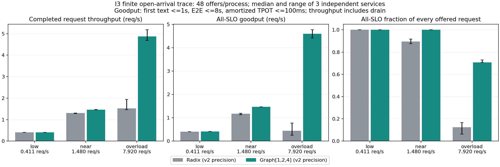
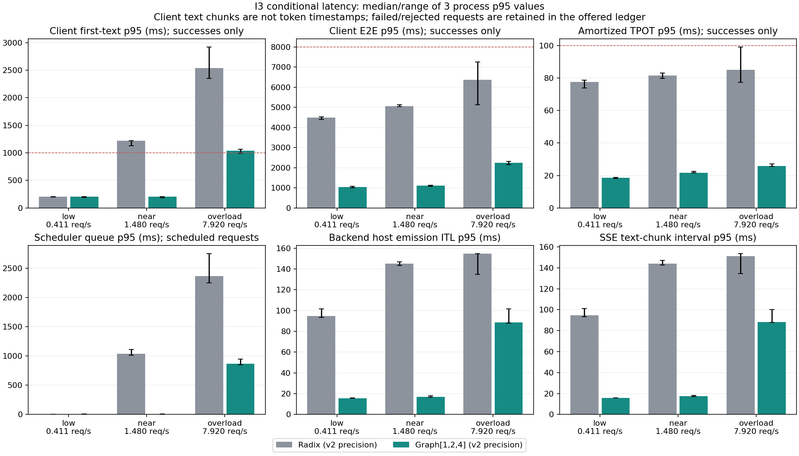
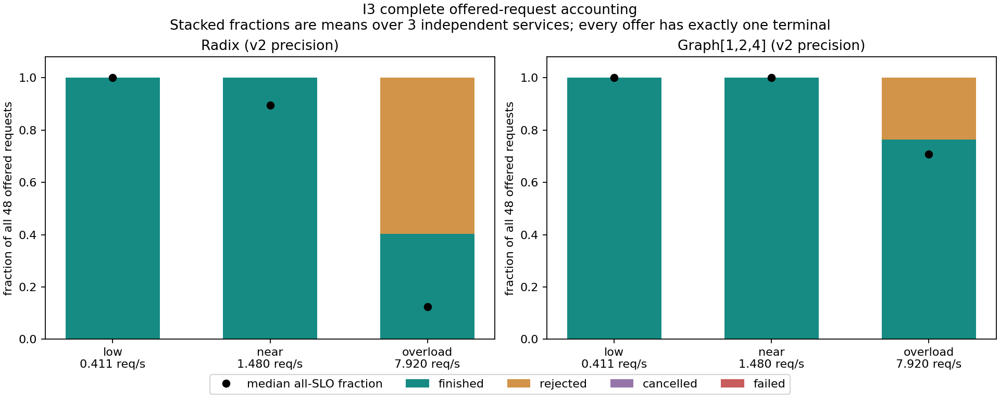

# I3 本机在线负载最终验收

2026-11-01：**本机 FI/TP1 的 I3 已完成。**
[最终验收](acceptance.json)的23项检查和[独立总审计](online001/audit.json)的3889项
检查全部通过：3840个数值资格向量、26项CPU测试、18个正式服务进程和864个
offered请求均可核对。全部进程退出，GPU末态0 MiB / 0%，未使用付费资源。

本轮比较同一精度下的 Radix 与 Graph[1,2,4]，只有 Graph 开关/桶不同，Overlap关闭。
框架为 pinned Mini-SGLang、FlashInfer FA2、Qwen3-0.6B、共享tokenizer、page1、
2048页、maxrunning4、admission8、context1024。[环境版本](environment.json)包括
Torch2.9.1+cu129、Transformers4.57.3、FlashInfer0.7.2.post1、sgl-kernel0.3.21。
供应商树仍为 `8ba75c4d14eb6cc985a254fd5185606d62da9061`。

## 新精度资格与失败保留

I3新文本使原I2 mixed出现3个首步数值越界，最坏相对RMSE .0055649；失败、源快照、
HF参考和张量保留在 [v1报告](../i3_online_v1/README.md)。完整975批次重放精确
复现全部1664个Radix向量及两个失败；仅提高head精度未解决。upper8虽通过但余量
很小，最终选择upper16，并另立 [v2协议](../../../docs/i3_online_protocol_v2.md)。
原I2验收仍属于其有限输入范围，原源码、配置和结果未改。

新策略：下12层保留FP16主路径与FP32残差/norm，最后16层的线性、norm、QK norm、
RoPE和MLP activation及最终norm/head使用FP32；FlashInfer attention和KV仍为FP16，
TF32关闭。策略在真正Graph构造/捕获之前安装，实际dtype、capture keys、replay及
source SHA有记录，全部转换、FP32计算和多kernel开销包含在服务计时中。新性能
范围不能直接与旧I2混排，也不代表FP32数学的最低成本。

[qual001独立审计](qual001/audit.json)覆盖每策略48正式payload、4warmup和8个
未参与精度诊断的seed20261102输入，合1920向量/策略、3840向量。每步全部151936
词表与独立HF FP32 eager比较，沿各策略实际原生greedy continuation重算。
`atol=.125, rtol=.02, relative_RMSE<=.005`不变，全部通过，最坏相对RMSE为
.0042069（0.4207%）。每策略1919/1920个向量top1相同，不声称自然生成序列或质量一致。

同一资格服务重新覆盖queued/decode/deadline取消、四个阻塞请求与后续probe，
核对客户端终态、后端结束、table/KV、frontend/detokenizer引用和关闭。22个最终
pilot/资格/正式服务的最长关闭时间4.735秒，worker均exit0、无升级、无残留。
API父进程明确收到计划SIGTERM；Uvicorn清理后可能重发该信号，rc=-15被如实记录。
这与worker升级/强杀分开检查。v1的父进程退出码审计误判也原样保留。

v2的pilot001执行成功，后来为更慢精度把资格阻塞请求固定为128token、客户端30秒
（服务端仍20秒），源码/配置绑定变化后重新运行pilot002；旧目录及说明保留。
该诊断预算不进入正式48请求，不改变正式15秒客户端预算或SLO目标。

## 冻结的负载与指标

| 类型 | 每进程请求数 | 实际prompt tokens | 输出上限 |
| --- | ---: | ---: | ---: |
| short | 24 | 102–103 | 16 |
| long | 12 | 462–463 | 32 |
| shared prefix | 12 | 411–412 | 64 |

模型执行原生greedy，ignore_eos，仅固定各类输出上限，没有替换生成token。
四个独立warmup不纳入正式指标。每进程48个唯一payload；同一指数间隔trace按
rate缩放，两策略和三轮复用相同payload顺序与计划到达表。客户端并发48，释放
请求不等待前一请求完成。发送滞后最坏p95为8.84ms、最大24.53ms，18次均通过
预设的p95<=50ms/max<=250ms门槛。
chat template在客户端预先渲染；请求指标包含HTTP、服务端tokenize和流式响应，
不包含服务启动/JIT、warmup或客户端构造payload的时间。

[独立pilot审计](pilot002/audit.json)从闭环并发4的原始时间段重新估算容量，仅
用于定档，不视为稳态容量。预设规则为慢策略capacity×.25/×.9，以及快策略×1.5；
冻结实际rate为 **0.411127 / 1.480056 / 7.920393 req/s**。near围绕较慢Radix，
没有声称同时接近Graph饱和。正式执行三档×两策略×三独立服务进程，按正/逆/轮转
与交替策略顺序平衡，见[冻结到达表](online001/schedule.json)和[准入绑定](online001/gate.json)。

SLO在pilot前固定：从计划到达至首个非空SSE文本<=1秒、E2E<=8秒、客户端摊销
TPOT<=100ms；成功且三者同时满足才计goodput。指标分母为
`max(48/rate, 最后终态-到达原点)`，包括drain；SLO成功率分母始终为全部48个offer。
所有864请求恰好一个终态；共744完成、120拒绝，无非预期失败或正式超时取消。

API的usage不可靠，输入/输出量使用tokenized和scheduler_token实际事件核对。
客户端首文本TTFT、整段摊销TPOT、后端逐token发射ITL和SSE文本块间隔分别报告。
后端发射时间是host观测，不是CUDA kernel计时；文本块不视为单个token。

## 完整六格结果

下表为三进程中位数，括号内为三进程最小/最大值；范围不是置信区间。

| 档位 | 策略 | 完成吞吐 req/s | goodput req/s（范围） | 全部offered SLO达标率（范围） | 每48请求拒绝数 |
| --- | --- | ---: | ---: | ---: | ---: |
| low | Radix | .405 | .405（.405–.407） | 100% | 0 |
| low | Graph | .411 | .411（.411–.411） | 100% | 0 |
| near | Radix | 1.303 | 1.173（1.126–1.195） | 89.58%（87.50–91.67%） | 0 |
| near | Graph | 1.467 | 1.467（1.466–1.468） | 100% | 0 |
| overload | Radix | 1.529 | .438（.255–.777） | 12.50%（6.25–16.67%） | 28–30 |
| overload | Graph | 4.877 | 4.606（4.422–4.770） | 70.83%（70.83–72.92%） | 10–12 |

near的配对goodput比中位为1.252（1.227–1.303）；overload为10.887
（5.930–17.348），配对绝对差中位4.167 req/s。过载范围很宽、每次只有48个offer，
不据此宣称稳定10.9倍或生产容量。low全部满足目标，约1.5%的goodput差主要体现
有限trace的drain边界，不解释为低负载容量收益。

| 档位/策略 | 文本TTFT p95 ms | E2E p95 ms | 摊销TPOT p95 ms | scheduler队列 p95 ms |
| --- | ---: | ---: | ---: | ---: |
| low / Radix | 204.5 | 4496.5 | 77.5 | 5.4 |
| low / Graph | 203.2 | 1044.5 | 18.7 | 5.5 |
| near / Radix | 1220.2 | 5058.3 | 81.5 | 1040.5 |
| near / Graph | 203.4 | 1117.1 | 21.7 | 5.7 |
| overload / Radix | 2535.9 | 6375.7 | 85.0 | 2364.5 |
| overload / Graph | 1040.9 | 2241.4 | 25.7 | 867.4 |

这些是每进程条件p95的三进程中位，失败/拒绝未补零。低档首文本时间相近，因为
Graph捕获的是decode；后续生成的E2E已缩短。near基线的主要SLO缺口出现在排队与
首文本时间，Graph释放更多执行容量后队列减小。过载Graph仍会拒绝请求，全部offer
达标率下降；只看成功请求的延迟会遗漏这部分损失。

near档的完整条件分位数示例（每进程分位数的三进程中位，单位ms）：

| 指标 | Radix p50/p95/p99 | Graph p50/p95/p99 |
| --- | ---: | ---: |
| 客户端首文本 | 189.0 / 1220.2 / 1557.2 | 121.8 / 203.4 / 214.1 |
| 客户端E2E | 2437.8 / 5058.3 / 5509.5 | 518.2 / 1117.1 / 1177.9 |
| 客户端摊销TPOT | 73.1 / 81.5 / 84.7 | 14.1 / 21.7 / 25.6 |
| scheduler队列 | 6.0 / 1040.5 / 1415.1 | 4.0 / 5.7 / 6.8 |
| 后端发射ITL | 66.9 / 145.2 / 183.5 | 13.1 / 17.0 / 103.2 |
| SSE文本块间隔 | 67.1 / 144.2 / 182.7 | 13.1 / 17.4 / 104.5 |

摊销TPOT目标没有要求每一个token或文本块间隔都<100ms，Graph的近饱和档发射
ITL p99仍约103ms。所有六格的p50/p95/p99与样本量均在CSV/JSON中，没有把多进程
请求池化成伪独立样本，也没有把少量请求的经验p99外推为生产尾延迟。

| 档位/策略 | 接纳input token/s中位 | 完成output token/s中位 | prompt cache命中率中位 |
| --- | ---: | ---: | ---: |
| low / Radix | 109.35 | 12.96 | 35.78% |
| low / Graph | 111.02 | 13.16 | 35.78% |
| near / Radix | 351.91 | 41.70 | 38.78% |
| near / Graph | 396.03 | 46.93 | 35.78% |
| overload / Radix | 368.11 | 45.57 | 33.04% |
| overload / Graph | 1365.93 | 152.64 | 38.95% |

实际prefix驱逐为2725–8890页/进程，计算prefill为2825–8324 query tokens/进程；
两者受接纳请求数和实际顺序影响，不能把绝对驱逐数直接当效率排名。本轮重prefill
请求数为0；锁定scheduler没有运行请求抢占机制，不将这个观测虚构为抢占验收。
Radix实际Graph replay为0；Graph为320–1285个批次/进程，实际batch覆盖1/2/3/4。

## 图表、证据与复现





图同时提供同名SVG。[864行逐请求CSV](online001/requests.csv)、
[18行运行CSV](online001/runs.csv)、[六格完整统计](online001/statistics.csv)、
[三档配对比较](online001/comparisons.csv)、[导出哈希](online001/export.json)完整归档。
独立审计重算数值、pilot、raw HTTP/后端事件、所有指标、实际Graph、到达滞后、
顺序、无数值复制和关闭。正式服务没有复制logits；读写观察日志的开销包含在测量中，
结果属于当前有观测的HTTP栈。温度/时钟仅在服务启动前或进程退出后留样，未当作
kernel运行时遥测。

26项CPU证据见 [cpu_tests.json](cpu_tests.json)，涵盖开放到达/分母/缺失延迟、
准入负对照、FP32残差与dtype边界、tied head、回滚和捕获前安装。
各阶段source snapshot、模型/输入/日志/张量哈希分层保存；大张量、模型和原始日志
放在ignored runtime，Git保留紧凑证据。仅克隆Git不包含全量张量，完整重算需要
恢复这些原始文件及锁定环境。

本次实际链路为 `workload002 → pilot002 → qual001 → online001`：

```bash
runs/envs/mini-sglang/bin/python scripts/run_i3_online.py --stage prepare --attempt workload002
runs/envs/mini-sglang/bin/python scripts/run_i3_online.py --stage pilot --attempt pilot002 --source results/i_minisglang/i3_online_v2/workload002
runs/envs/mini-sglang/bin/python scripts/audit_i3_pilot.py --directory results/i_minisglang/i3_online_v2/pilot002
runs/envs/mini-sglang/bin/python scripts/run_i3_online.py --stage qualification --attempt qual001 --source results/i_minisglang/i3_online_v2/workload002
runs/envs/mini-sglang/bin/python scripts/audit_i3_qualification.py --directory results/i_minisglang/i3_online_v2/qual001
runs/envs/mini-sglang/bin/python scripts/run_i3_formal.py --attempt online001 --qualification results/i_minisglang/i3_online_v2/qual001 --pilot results/i_minisglang/i3_online_v2/pilot002
runs/envs/mini-sglang/bin/python scripts/audit_i3_online.py --directory results/i_minisglang/i3_online_v2/online001
runs/envs/i2-report/bin/python scripts/export_i3_online.py --directory results/i_minisglang/i3_online_v2/online001
runs/envs/mini-sglang/bin/python scripts/accept_i3_online.py --directory results/i_minisglang/i3_online_v2/online001
```

以上是执行记录，已有目录拒绝覆盖。新实验使用新目录并签发对应门槛；不要修改
已验收计算源码/协议。现有本机证据可以只读复核而不重写审计：

```bash
runs/envs/mini-sglang/bin/python - <<'PY'
import json
from pathlib import Path
from scripts.audit_i3_online import audit
p = Path('results/i_minisglang/i3_online_v2/online001')
assert audit(p) == json.loads((p / 'audit.json').read_text())
print('Frozen I3 audit reproduced without overwriting evidence')
PY
```

结论限于本机FI/TP1、固定48请求trace、受控输出长度和新精度；未验收长期稳态、
生产分布或多卡。下一步按执行计划进行H3计时稳定性复验与本机交付准备，TP2/4仍
留待后期集中租卡。个人复盘、面试指南及知识验收留待全部实验完成后统一整理。
